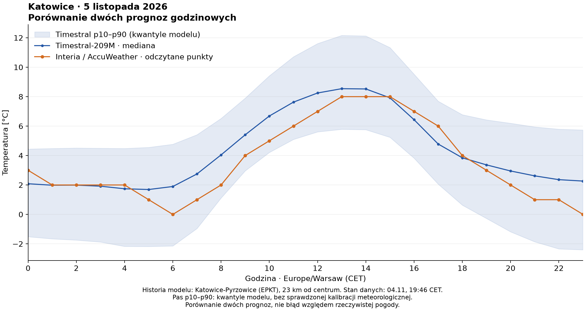

# Katowice: prognoza na 5 listopada 2026

Timestral-209M przez POST /forecast. Job: `job_759bb5c007cab3284ecc5577`; wynik: `result_2e9feee0fca36f660f4d1968`; historia: `ds_c38342c6d61f8dfb4e5dc5bd`. Zero-shot, bez fine-tuningu, use_cache=false. REST HTTP loopback na PC przez SSH.

Historia: obserwacje METAR stacji EPKT Katowice-Pyrzowice, 50.4694°N, 19.0764°E, 284 m n.p.m.; około 23.0 km od przyjętego centrum Katowic. [Źródło IEM](https://mesonet.agron.iastate.edu/cgi-bin/request/asos.py?station=EPKT&data=tmpc&year1=2026&month1=10&day1=5&year2=2026&month2=11&day2=5&tz=Etc%2FUTC&format=onlycomma&latlon=yes&elev=yes&missing=M&trace=T&direct=no&report_type=3&report_type=4); [metadane](https://mesonet.agron.iastate.edu/geojson/network/PL__ASOS.geojson). Pobrano 2026-11-04T18:46:23.769043+00:00. Obserwacje stacji, nie reanaliza ani prognoza.

Cutoff: 2026-11-04T18:46:23.769011+00:00. Ostatnia użyta obserwacja: 2026-11-04T17:30:00+00:00. Kontekst UTC: 2026-10-05T18:00:00+00:00 – 2026-11-04T17:00:00+00:00, 720 godzin, 0 braków. Duplikaty timestampów uśredniono, potem wyliczono średnią w zakończonych przedziałach [h,h+1h), oznaczanych początkiem godziny. Odrzucono bieżącą niepełną godzinę. Braków nie wypełniano przyszłymi danymi.

Target i jedyna numeryczna cecha: temperature_c. Bez dodatkowych covariates. Horyzont: 29 godzin do 2026-11-05T22:00:00+00:00. Wybrano dokładnie 24 godziny 2026-11-05 00–23 Europe/Warsaw (UTC+1). Żadna przyszła temperatura, w tym Interia, nie trafiła do modelu.

Interia: [Interia / AccuWeather](https://pogoda.interia.pl/prognoza-szczegolowa-katowice,cId,13095), pobrano 2026-11-04T18:46:58.222Z. 24 faktyczne punkty i 24 wspólne godziny, bez interpolacji.

| CET | Timestral mediana [°C] | Interia [°C] |
|---|---:|---:|
| 00:00 | 2.08 | 3.0 |
| 06:00 | 1.90 | 0.0 |
| 12:00 | 8.25 | 7.0 |
| 18:00 | 3.85 | 4.0 |

Min/max Timestral: 1.69/8.54 °C; Interia: 0.0/8.0 °C. Średnia różnica Timestral − Interia: 0.69 °C; MAE między prognozami: 0.97 °C.

To rozbieżność dwóch prognoz, nie błąd względem rzeczywistej pogody: prognozowany dzień jeszcze nie nastąpił. Timestral ekstrapoluje historię szeregu bez modelu atmosfery, przyszłych frontów i pól meteorologicznych. Stacja lotniskowa może nie odzwierciedlać temperatury centrum miasta. To eksperyment, nie oficjalna prognoza meteorologiczna. Kwantyle p10–p90 są wynikiem modelu, bez zweryfikowanej kalibracji dla tej stacji.

| Pomiar | Sekundy |
|---|---:|
| load_model_seconds | 0.000000 |
| inference_seconds | 0.031186 |
| api_duration_seconds | 0.035992 |
| worker_seconds | 0.264243 |
| queue_seconds | 0.203975 |
| submit_http_seconds | 0.008395 |
| client_wall_seconds | 0.712707 |

Inference_seconds: rzeczywista inferencja z synchronizacją CUDA. Load_model_seconds: ładowanie wag. API duration: całe przetwarzanie. Worker = finished−started, kolejka = started−created. Klient: perf_counter od wysłania /forecast do odebrania zakończonego zadania, w tym polling co >=1,1 s i zapis odpowiedzi.

Artefakty: forecast_client.py, compare.py, surowe obserwacje i metadane IEM, source.json, history-hourly-utc.csv, request.json, api-raw.json, job.json, forecast-full.csv/.parquet, timestral-tomorrow.csv, interia-reference.json, hourly-comparison.csv, model-summary.json, report.json, chart.png/.svg.
